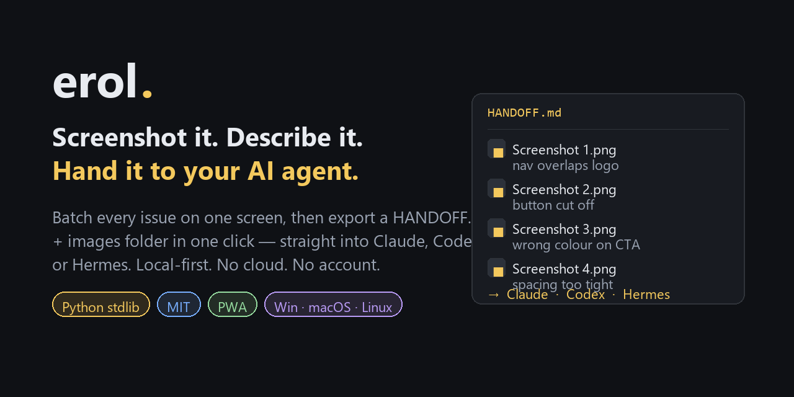

<div align="center">



# erol.

**Screenshot it. Describe it. Hand the whole batch to your AI agent.**

[](LICENSE)
[](server.py)
[](#local-quick-start-the-main-path)
[](#why-erol-exists)
[](#contributing)

</div>

---

## Why Erol exists

The old loop: spot something broken → screenshot → paste it into Claude/Codex/Hermes →
describe it → repeat.

That works for **one** issue. The moment you have five, you're juggling filenames and
rewriting the same context over and over — and you'll forget which screenshot went with
which bug.

Erol turns that into: **spot → screenshot → one-line note → one click.** Every issue
stays on one screen, each screenshot paired with its description, and the whole batch
leaves as a single handoff folder.

It's **local-first by design** — no cloud, no account, no telemetry. Your screenshots
never leave your machine.

---

## What you get

A handoff folder containing `HANDOFF.md` plus the images, ready to drag into an agent:

```markdown
# Handoff — 2026-10-08 11:36

## Screenshot 1.png
nav overlaps logo on narrow widths

## Screenshot 2.png
primary button is cut off at 1280px
```

You can also flip on **publish authorization** in the handoff, so the agent is
explicitly cleared to ship the fix instead of stalling at the deploy step.

---

## How it works

1. **Take a screenshot.** Erol watches your screenshots folder (or you can paste with
   `Ctrl+V`), and each new image appears as a card.
2. **Describe the issue.** Type a short note under each card. Works for as many
   screenshots as you like, all on one screen.
3. **Hand off.** Click **→ Hand off to AI**. Erol bundles everything — the screenshots
   and a `HANDOFF.md` that lists each image with its description — into a folder named
   after the export time, and opens it in Explorer. Drag the folder into your AI agent
   (or a colleague, or a ticket) and you're done.

Per-card actions: **Set aside** (hide without deleting the file), **Delete** (hide
permanently, file on disk untouched), **Clear all** (start fresh). It's a PWA too, so
you can install it as a standalone window.

---

## Local quick start (the main path)

Requires **Python 3.8+**. No dependencies.

```bash
git clone https://github.com/andygauk/erol.git
cd erol
python server.py
```

Open **http://localhost:8000/** (or the LAN IP your machine shows). Erol watches a
`screenshots/` folder next to the project by default.

### Point it at your real screenshot folder

Copy the example config and edit the path:

```bash
cp config.example.json config.json
```

```json
{ "screenshots_dir": "C:\\Users\\you\\Pictures\\Screenshots" }
```

Erol will watch that folder and auto-signal every new screenshot it finds.

### LAN access (another device / your phone)

```bash
python server.py --host 0.0.0.0 --port 8005
```

Then open `http://<your-PC-IP>:8005/` from any device on the same Wi-Fi. (The default
`127.0.0.1` binding is local-only on purpose; use `0.0.0.0` to expose it on the network.)

---

## Hosted mode (optional, for teams)

A Cloudflare Worker backend (`worker/index.js`, using D1 for metadata and R2 for images)
lets Erol run as a shareable web app where people paste/upload screenshots. To deploy
your own instance you need your own Cloudflare D1 + R2 bindings:

- Run `build.ps1` (produces `dist/`) or wire `worker/index.js` directly.
- Bind the Worker to a D1 database (`DB`) and an R2 bucket (`IMAGES`). `worker/index.js`
  is the whole backend — it's self-contained and uses only those two bindings.
- The browser UI is the same single `index.html`, so paste/upload works but (being web)
  it cannot read anyone's local screenshot folder — that's the local mode's job.

> The hosted mode is entirely optional. The local mode is the point of Erol.

---

## Where things are

| Path | Purpose |
|---|---|
| `server.py` | Local server (Python stdlib, no deps). Watches the folder, serves the UI, builds handoff folders in `export/`. |
| `index.html` | The whole UI (single file). Works in both local and hosted mode. |
| `worker/index.js` | Optional Cloudflare Worker backend for the hosted mode. |
| `manifest.webmanifest`, `sw.js`, `icon-*.png`, `favicon.png`, `logo.png` | PWA manifest, service worker, and icons — makes Erol installable as an app. |
| `config.json` | **Your** screenshot-folder override (gitignored — never commit it). |

Generated material (archived/cleared cards, export bundles, pasted images, saved
descriptions) lives in `archive/`, `export/`, `captures/`, and `descriptions.json` —
all gitignored so they never pollute a shared repo.

---

## Development

```bash
python server.py            # run locally (127.0.0.1:8000)
python server.py --host 0.0.0.0 --port 8005   # LAN-reachable
```

Erol is deliberately small: one Python file for the backend and one HTML file for the
UI. No build step, no framework, no `npm install`. Change something, refresh the page.

---

## Contributing

Issues and PRs are welcome — this is a small tool built to scratch a real itch, and it's
better if it scratches yours too.

Good first contributions:

- **Other screenshot folders / OSes** — better defaults for macOS and Linux capture dirs.
- **Handoff formats** — templates for Jira, Linear, GitHub Issues, or plain checklists.
- **Keyboard-first flow** — a shortcut to focus the next undescribed card.
- **Accessibility** — Erol is keyboard- and screen-reader-usable, and I want it to stay
  that way.

Open an issue first for anything large so we can agree on the shape before you write it.

---

## License

[MIT](LICENSE). Free to use, modify, and share.
